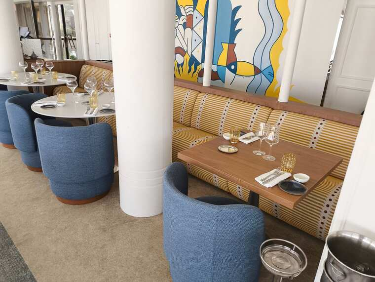

<p align="center">
  <!-- Les Trois Forts - App Icon -->
  <a href="https://sofitel-service-lestroisforts.vercel.app" target="_blank">
    
  </a>
</p>


<p align="center" style="width:512px; margin:0 auto;">
  <b>Les Trois Forts — Service Academy</b> is a pocket training app for the service team of <b>Les Trois Forts</b>, the restaurant of the Sofitel Marseille Vieux-Port: menus, wines, cocktails, cheese board, quizzes, the daily briefing and a team chat, in one installable PWA.
</p>

<p align="center" style="margin-top:12px;">
    <a href="https://sofitel-service-lestroisforts.vercel.app" target="_blank"><b>Open the Service Academy &rarr;</b></a>
</p>


# `sofitel-service-lestroisforts`

> IMPORTANT: This is a personal training tool built by a server of the team, for the team. It is **not** an official Sofitel / Accor product, and the menu content is transcribed from the restaurant's real cards (October 2026): always confirm allergens with the kitchen ;)


## What is the Service Academy? 🍽️

Picture your first week on the floor 🏃🏽‍♂️: a guest points at the wine list and asks for "something like a Bandol, but white", table 21 wants to know what comes with the *loup*, the bar needs a *Romarin Tonic* and the chef just changed the carte for winter ❄️. That's a lot to remember! 😅

The **Service Academy** turns all of it into a game 🎮. Every dish, wine, champagne, cocktail, coffee, tea, digestif and cheese of **Les Trois Forts** becomes a flash card 🃏 with a photo 📸, a "what to tell the guest" note 💬, the English version 🇬🇧 and the right pronunciation 🔊. Then you play: quizzes ❓, a 60-second chrono ⏱️, a bar game where you build the cocktail 🍸, a "find the table" game on the floor plan 🗺️ and a final exam 🎓 with a certificate 🏆 at the end.

Before service, the **daily briefing** 📋 shows the tasting menu of the day, the reserved tables (in gold on the plan) and the catch of the day 🐟. During the shift, the **team chat** 💬 keeps everyone in sync, and the **scan** 📷 recognises a plate, a label or a bottle straight from the camera, even offline ✈️.

It runs in French 🇫🇷 or English 🇬🇧, in ☀️ light, 🌙 dark or ⚫ black, installs on any phone like a native app 📱, and works offline once loaded. Under the hood, the whole app is written in **Rust** 🦀 and compiled to **WebAssembly** ⚡.

> MOTTO: We'll always do [**more**](#more) 😜


---


## Chapters 📚

| No. | Chapter | ID | What you learn |
|:----|:--------|:---|:---------------|
| 1 | *`Service du jour`* | `jour` | The daily briefing: tasting menu of the day, table plan (reserved tables in gold), notes & catch of the day |
| 2 | *`Carte d'hiver 3F`* | `hiver` | The winter menu (from 19 October 2026): 14 dishes + 4 desserts, pictograms, lunch or dinner, allergens, staff notes |
| 3 | *`Déjeuner`* | `dej` | The lunch menu & the weekly 49 € formula |
| 4 | *`Dîner & Dégustation`* | `diner` | The dinner menu & the 89 € Tasting Menu "Voyage en Méditerranée" |
| 5 | *`Desserts & Fromages`* | `dess` | Desserts & the Lemarié cheese board |
| 6 | *`Plateau de fromages`* | `from` | The 8 cheeses, mildest to strongest: milk, origin, place on the board |
| 7 | *`Cocktails & Softs`* | `cock` | Signatures, recipe cards (doses, glass, garnish, method), softs & waters |
| 8 | *`Cafés & Thés`* | `cafe` | Illy coffees (lunch & dinner prices differ!) & the Maison Père Blaize teas |
| 9 | *`Vins`* | `vins` | By the glass & by the bottle: appellation, producer, vintage, region, palate, grapes |
| 10 | *`Champagnes`* | `champ` | Glasses, bruts, rosés & prestige cuvées |
| 11 | *`Digestifs`* | `dig` | Ferroni, Lachanenche & the Liquoristerie de Provence: producer, price, measure |
| 12 | *`Accords mets-vins`* | `acc` | The Tasting Menu wine pairing (+55 €): which wine with which course, grapes, how to describe it |
| 13 | *`Plan de salle`* | `plan` | The table numbers of the floor plan |


### Game modes 🎮

| No. | Mode | Where | What it does |
|:----|:-----|:------|:-------------|
| 1 | *`Étudier`* | every chapter | Flash cards with photos: tap to flip, "review again" or "I know it" |
| 2 | *`Quiz`* | every chapter | 10 questions with explanations, weighted towards what you don't know yet |
| 3 | *`Chrono`* | every chapter | 60 seconds, combos up to ×5, a record per chapter |
| 4 | *`Le Bar`* | Cocktails | Build the ordered cocktail: ingredients, glass & garnish |
| 5 | *`Trouve la table`* | Plan de salle | "Tap table T21" on the floor plan |
| 6 | *`Briefing`* | Service du jour | Tables, notes & the catch of the day |
| 7 | *`Allergènes`* | Carte d'hiver | The allergen table, dish by dish (indicative only) |
| 8 | *`Réviser`* | Réviser tab | A quiz of your mistakes |
| 9 | *`Examen final`* | Réviser tab | 3 questions per chapter; 80% or more = the certificate 🏆 |

> NOTE: The XP, ranks (Commis → Directeur de salle), streak 🔥, records and mistakes are saved on the phone, and in the cloud ☁️ once you sign in with Google.


### Features ✨

- 📖 **La Carte**: the whole menu with search (accents ignored), course tabs (Pour commencer · Entrées · Plats · Fromages · Desserts), chapter chips and the cheese strength scale 🧀.
- ℹ️ **ⓘ sheets**: what to tell the guest, the chef's & service notes, "Did you know?" tips 💡, palate 👅 & grapes 🍇 (with audio 🔊).
- 🔊 **Pronunciation**: every name in French, English and its original language (Italian, Spanish, Japanese...) with the phone's voices; grape names with recorded audio.
- 📸 **Your own photos**: take or pick a photo of any dish or bottle; it stays on your phone (IndexedDB) and the scan learns from it.
- 📷 **Scan**: MobileNet v2 image match + Tesseract OCR (French), 100% on-device, works offline after the first use; taps on the right result are remembered.
- 💬 **Team chat**: messages, photos, replies (swipe right ↩️), reactions 😍 and an unread dot 🔴, for signed-in team members only.
- ☁️ **Google sign-in & cloud sync** (Firebase): progress & settings follow you on every device; photos stay on the phone.
- 🧭 **Deep links & refresh-safe**: `#/<view>/<chapter>` URLs, and a refresh lands back on the same card or question.
- 🌗 **Themes**: Auto · Clair · Sombre · Noir, with no flash of the wrong theme.
- 📴 **Offline**: a network-first service worker, plus a persistent cache for the scan engine.


---


## Tech stack & versions 🧰

Versions as built on 2026-10-19:

| Tool | Version | Notes |
|:-----|:--------|:------|
| [Rust](https://www.rust-lang.org) | **stable** (cargo 1.99.1) | Target `wasm32-unknown-unknown`, edition 2021. Release profile: `opt-level = "z"`, LTO, `panic = "abort"`. |
| [wasm-bindgen](https://github.com/wasm-bindgen/wasm-bindgen) | **=0.2.129** | Pinned: the CLI and the crate must match. `--target no-modules`. |
| `js-sys` / `web-sys` | **0.3.106** | Only the Web APIs the app uses (DOM, IndexedDB, Web Speech, Web Audio...). |
| `serde_json` | **1.0.154** | `preserve_order`, so the saved progress keeps the exact JSON shape of the JS app. |
| [binaryen](https://github.com/WebAssembly/binaryen) (`wasm-opt`) | **version_133** | `-Oz` on the final wasm. |
| [Firebase JS SDK](https://firebase.google.com/docs/web/setup) | **10.12.2** | Google sign-in, Firestore (progress sync & team chat). Spark (free) plan. |
| [TensorFlow.js](https://www.tensorflow.org/js) + MobileNet v2 | **4.22.0** / **2.1.1** | Image embeddings for the scan; weights converted to float16. Unminified builds in `scan/vendor/`. |
| [Tesseract.js](https://tesseract.projectnaptha.com) | **5.1.1** | French OCR for the labels (as published, in `scan/vendor/`). |
| [Node.js](https://nodejs.org) | **>= 18** | Build tools (data conversion) & tests. |
| [jsdom](https://github.com/jsdom/jsdom) / [fake-indexeddb](https://github.com/dumbmatter/fakeIndexedDB) | **24** / **6** | Tests. |
| [Vercel](https://vercel.com) | static | No framework, no build: `rust/dist` is deployed as is. |


## How it works 🦀⚡

The app started as a JavaScript PWA (`pwa/app.js`) and was then rewritten, screen by screen, in Rust. The Rust port renders **exactly the same HTML**, uses the same `localStorage` key (`ltf_v1`, same JSON shape) and the same IndexedDB photos (`ltf_photos`), so nothing changed for the team when it went live. The JavaScript app is kept as the reference: the tests render both apps side by side and compare them.

| No. | Piece | File | What it does |
|:----|:------|:-----|:-------------|
| 1 | *`Entry point`* | [src/rust/ltf/src/lib.rs](./src/rust/ltf/src/lib.rs) | Loads the progress, builds the items, attaches the `window.LTF*` API, opens the URL's screen |
| 2 | *`State`* | [src/rust/ltf/src/state.rs](./src/rust/ltf/src/state.rs) | The saved progress `S` & the runtime UI state |
| 3 | *`Chapters & questions`* | [src/rust/ltf/src/build.rs](./src/rust/ltf/src/build.rs) | Every item and every question generator, from the embedded menu data |
| 4 | *`Screens`* | [src/rust/ltf/src/ui.rs](./src/rust/ltf/src/ui.rs) | Router, navigation, every screen, La Carte, settings |
| 5 | *`Media`* | [src/rust/ltf/src/media.rs](./src/rust/ltf/src/media.rs) | Beeps, speech, IndexedDB photos, the photo viewer, confetti |
| 6 | *`Utilities`* | [src/rust/ltf/src/util.rs](./src/rust/ltf/src/util.rs) | JavaScript semantics in Rust (`String()`, truthiness, `trim`, `normalize`...) & DOM helpers |
| 7 | *`Team chat`* | [chat.js](./chat.js) | Firestore collection `chat` (ES module) |
| 8 | *`Cloud sync`* | [cloud.js](./cloud.js) | Google sign-in & the `users/{uid}` progress doc (ES module) |
| 9 | *`Scan`* | [scan.js](./scan.js) | On-device image + label recognition |
| 10 | *`Service worker`* | [sw.js](./sw.js) | Network first, offline fallback, persistent scan cache |
| 11 | *`JavaScript reference`* | [src/pwa/app.js](./src/pwa/app.js) | The original app the Rust port is compared against |


## Structure 🗂️
> IMPORTANT: This repo holds the **built** app (it's what Vercel serves) + a copy of the readable sources in [`src/`](./src).

```sh
.
├── index.html               # app shell: CSS, inline helpers (table plan, crew code, grapes, cheese scale...)
├── ltf.js                   # wasm-bindgen glue
├── ltf_bg.wasm              # the whole app, in Rust (+ the embedded menu data)
├── sw.js                    # service worker (cache `ltf-v44-rs`)
├── chat.js                  # 💬 team chat
├── cloud.js                 # ☁️ Google sign-in & cloud sync
├── scan.js                  # 📷 photo scan
├── names.js                 # 🔐 encrypted briefing data (AES-GCM)
├── manifest.json            # PWA manifest
├── img/                     # dish, wine, cocktail & cheese photos
├── say/                     # 🔊 grape pronunciations (mp3)
├── scan/                    # scan engine: model (MobileNet v2 float16), French data, embeddings
│   └── vendor/              # 📦 third-party libraries (TensorFlow.js, MobileNet, Tesseract), see its README
├── src/
│   ├── pwa/                 # the JavaScript sources (index.html, app.js reference, data files, chat, cloud, scan, sw)
│   └── rust/
│       ├── ltf/             # the Cargo crate (Cargo.toml, src/*.rs)
│       ├── tools/           # data generators, names encryptor, scan tools
│       ├── web/sw.js        # the service worker source
│       ├── build.sh         # one-shot build -> dist/
│       └── setup_toolchain.sh
├── vercel.json              # headers (no-cache for index.html & sw.js, application/wasm)
├── CHANGELOG.md
├── CONTRIBUTING.md
├── LICENSE
└── README.md
```


## Getting Started 🚀

To build from the full project (`pwa/` + `rust/`):

```bash
# 1. the toolchain (Rust + wasm32, wasm-bindgen 0.2.129, binaryen, test deps)
bash rust/setup_toolchain.sh

# 2. build -> rust/dist/
cd rust && ./build.sh
```

| Step | Command | What it does |
|:-----|:--------|:-------------|
| `data` | `node tools/gen_data.js ../pwa ltf/data` | pwa/*.js menu data -> JSON embedded in the wasm |
| `tables` | `node tools/gen_appdata.js ../pwa ltf/data` | the icons & fixed facts of app.js -> JSON |
| `compile` | `cargo build --release --target wasm32-unknown-unknown` | the Rust app |
| `glue` | `wasm-bindgen --target no-modules ...` | `ltf.js` + `ltf_bg.wasm` |
| `size` | `wasm-opt -Oz ...` | a smaller wasm |
| `static` | `node tools/make_index.js ../pwa dist` + copies | index.html, sw.js, scripts, photos, scan, docs & `src/` |

To run it locally, serve `rust/dist` with any static server (e.g. `npx serve rust/dist`) and open it in your browser.

> NOTE: Google sign-in only works on the authorized domains of the Firebase project (the Vercel URL). Everything else works on `localhost`.


## Testing 🧪
> IMPORTANT: The tests run both apps in [jsdom](https://github.com/jsdom/jsdom) with the same seeded `Math.random` and a fixed clock, and compare them byte for byte.

```bash
mkdir -p /tmp/jt && cd /tmp/jt && npm init -y && npm i jsdom@24 fake-indexeddb@6
NODE_PATH=/tmp/jt/node_modules bash rust/tests/run_all.sh
```

| No. | Test | What it checks | Status | Date |
|:----|:-----|:---------------|:-------|:-----|
| 1 | *`t_rs.js`* | Walks every screen of the Rust app, LTFtest, speech, the photo viewer & the course filters | *Passed* (errors 0) | 2026-10-20 |
| 2 | *`compare.js`* | 40 steps × 4 runs (FR, EN, winter date, existing progress): JS vs Rust body HTML, items, LTFtest & saved progress; a full chrono round & the exam | *Passed* (0 diffs) | 2026-10-20 |
| 3 | *`photos.js`* | IndexedDB photos saved by the JS app show in the Rust app; upload → 900 px JPEG | *Passed* | 2026-10-20 |
| 4 | *`zoom.js`* | Photo viewer gestures (double tap, wheel, pan, pinch, reset, swipe down), JS vs Rust | *Passed* | 2026-10-20 |
| 5 | *`async_boot.js`* | The deployed index.html, async wasm load | *Passed* | 2026-10-20 |
| 6 | *`route.js`* | URL router, deep links, bad links, resumed quiz after a refresh | *Passed* | 2026-10-20 |
| 7 | *`check_readable.js`* | No single-letter identifiers & no minified code of ours (JS, Rust, Python, shell) | *Passed* (0 problems) | 2026-10-20 |

> NOTE: Hand checks on a real phone (installed PWA) are still needed for the camera, the speech voices & Google sign-in, which jsdom can't run.


## Privacy & security 🛡️

- 🙈 **No guest data in clear**: the briefing never shows guest names unless the team code is typed; the names ship encrypted (AES-GCM 256, PBKDF2-SHA256 600 000 rounds) in `names.js`.
- 🔐 **Firestore rules**: `users/{uid}` can only be read & written by that user; the chat is readable by signed-in users only, each user can only write their own messages and their own reaction, and delete their own messages.
- 📸 **Photos stay on the phone** (IndexedDB), except the ones a team member chooses to post in the chat.
- 🔑 The Firebase web config in `cloud.js` / `chat.js` is a public identifier by design; access is enforced by the rules above.


## More

These are some of the things we did or plan to do:

| No. | Name | File | Status |
|:----|:-----|:-----|:-------|
| 1 | *`Rust/WASM port`* | [src/rust/ltf](./src/rust/ltf) | Done |
| 2 | *`JS vs Rust compare tests`* | `rust/tests/` | Done |
| 3 | *`Daily briefing + table plan`* | [index.html](./index.html), `ui.rs` | Done |
| 4 | *`Google sign-in & cloud sync`* | [cloud.js](./cloud.js) | Done |
| 5 | *`Photo scan (offline)`* | [scan.js](./scan.js) | Done |
| 6 | *`Team chat`* | [chat.js](./chat.js) | Done |
| 7 | *`Grapes pronunciation`* | [index.html](./index.html), `say/` | Done |
| 8 | *`Breakfast menu`* | - | Pending |
| 9 | *`Photo sync across devices`* | - | Pending\* |

> NOTE: (\*) = needs Firebase Storage (paid plan). <br>
> There's certainly a couple of things we must've forgot, so we'll keep the above list updated obv. :)


## TODOs

- [ ] Add the breakfast menu
- [ ] Confirm the milk of the Tommette corse
- [ ] Confirm the colour of the Parés Baltà Electio & the herb of the Romarin Tonic (thyme vs rosemary)
- [ ] Add the grapes of the Cardillone & the Léoube Singulier blanc (back labels)
- [ ] Fill the allergens of the Tartare de Saint-Jacques (blank on the staff sheet)
- [ ] Real screenshots in this README (mobile & laptop, light & dark)


## Inspirations

The design & development of this project was inspired by the following:

| Name | Type | Inspired By |
|:-----|:-----|:------------|
| [*`duolingo`*](https://www.duolingo.com) | **`App`** | XP, streaks, short game modes, "review your mistakes" |
| [*`anki`*](https://apps.ankiweb.net) | **`App`** | flash cards weighted by what you don't know yet |
| [*`whatsapp`*](https://www.whatsapp.com) | **`App`** | the team chat: swipe to reply, reactions |
| [*`material 3`*](https://m3.material.io) | **`Design System`** | bottom sheets, tab bar, segmented controls |
| [*`ab-elements-app`*](https://github.com/abraham-ukachi/ab-elements-app) | **`Repo`** | code style, license headers, README, CHANGELOG & commit conventions |


---


## Screenshots 📸

| Hero | Tags |
|:-----|:-----|
|  | **Hub**: the hero of the home screen <br/> #hub, #hero, #lestroisforts |

> NOTE: More screenshots (mobile & laptop, light & dark) are coming, see [TODOs](#todos).


---

## License

This **`sofitel-service-lestroisforts`** project is [MIT Licensed](./LICENSE) ;)
